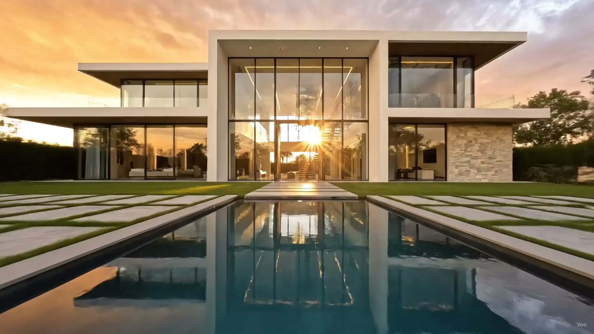

# The Pavilion Villa — Luxury Architectural Animated Experience

An ultra-high-end architectural web experience showcasing **The Pavilion Villa**, featuring a cinematic 60 FPS 3D canvas image sequence scrubbing engine, Lenis smooth scrolling, GSAP ScrollTrigger timeline choreography, dual Obsidian Dark & Alabaster Light architectural theme engine, and comprehensive editorial architectural monographs.



---

## ✨ Features & Architecture

- **60 FPS Hardware-Accelerated 3D Scrubbing**:
  - HTML5 Canvas rendering a 1,902-frame pre-rendered photorealistic sequence.
  - Multi-threaded off-main-thread image decoding using `HTMLImageElement.decode()`.
  - Imperative draw loop decoupled from React state to eliminate virtual DOM reconciliation overhead during rapid scroll.
  - Device pixel ratio (`window.devicePixelRatio`) retina rendering with cover-fit aspect ratio scaling.
  - Intelligent frame caching engine with progressive pre-buffering.

- **Kinetic Interior Timeline**:
  - Glassmorphic contextual spatial overlays at key architectural thresholds (*Entrance, Great Living Room, Minimalist Kitchen, Master Suite, Basalt Bath, Japanese Zen Garden*).
  - Floating room-by-room progress navigator with interactive smooth-jump capabilities.

- **Cinematic Navigation & Interactions**:
  - Frosted glass dynamic navigation bar with active section capsule indicator.
  - Real-time `IntersectionObserver` section detection.
  - Custom luxury magnetic cursor with smooth trailing spring physics.
  - Circular SVG scroll progress indicator (0% to 100%) fixed at bottom-right with dual-mode tap (scroll to next / smooth return to top).

- **Architectural Dual Theme Engine**:
  - **Obsidian Dark** (`#000000`) & **Alabaster Light** (`#f7f6f2`).
  - Seamless CSS variables transition with persistence in `localStorage`.
  - Architectural toggle switch integrated into the top navigation.

- **Deep Editorial Monograph Sections**:
  - **Philosophy & Monograph**: Architectural genesis, tectonic brutalism, and landscape dialogue.
  - **Spatial Program**: 12,400 sq.ft across 3 horizontal terraces with sequenced jump points.
  - **Materiality & Craft**: Board-formed volcanic concrete, honed basalt, silver travertine, and hot-rolled blackened steel.
  - **Engineering & Systems**: Geothermal radiant hydronics, BIPV solar glazing, and microgrid battery infrastructure.
  - **Private Acquisition**: Confidential inquiry desk for private client dossier requests.
  - **Monograph Colophon Footer**: Real-time Pacific Time clock, geographic coordinates, elevation, and directory links.

---

## 🛠️ Tech Stack

- **Framework**: [Next.js 15 (App Router)](https://nextjs.org/)
- **Language**: TypeScript
- **Styling**: [Tailwind CSS v4](https://tailwindcss.com/)
- **Animation & Timeline**: [GSAP 3](https://greensock.com/gsap/) & [ScrollTrigger](https://greensock.com/scrolltrigger/)
- **Smooth Scrolling**: [@studio-freight/lenis](https://github.com/darkroomengineering/lenis)
- **Icons**: [Lucide React](https://lucide.dev/)

---

## 🚀 Getting Started

### Prerequisites

Ensure you have [Node.js](https://nodejs.org/) (v18.17+ or v20+) installed.

### Installation

1. **Clone the repository**:
   ```bash
   git clone https://github.com/mdshadabirfan/villa-animated-website.git
   cd villa-animated-website
   ```

2. **Install dependencies**:
   ```bash
   npm install
   ```

3. **Start the local development server**:
   ```bash
   npm run dev
   ```

4. **Open in browser**:
   Navigate to [http://localhost:3000](http://localhost:3000) to view the experience.

---

## 📦 Build for Production

```bash
npm run build
npm run start
```

---

## 📄 License

Private & Confidential — Created for The Pavilion Villa Monograph. All rights reserved.
